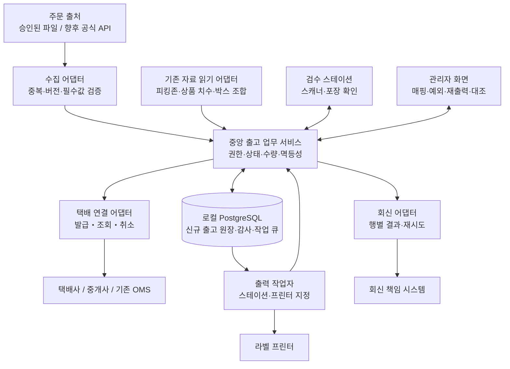

# AX-20261023-04 — 송장 출력·주문확인 통합 시스템 설계 초안 v0

저장 대상: `reports/AX-20261023-04/plan.md`  
작성: Codex / 기준일: 2026-10-23  
상태: 사용자 업무 확인 전 설계 초안

**이번 작업은 설계 문서 작성만 대상으로 한다. 코드 작성·수정, DB 변경, 실제 송장 발급·출력, 외부 전송은 수행하지 않는다.** Codex는 파일을 수정하지 않았으며, 이 최종 출력 내용을 AX 스크립트가 저장한다.

## 1. 목적 / 완료 조건

### 목적

기존 주문파일정리·자동 매칭·박스추천과 연결하면서, 주문확인 → 피킹 → 바코드 검수 → 송장 출력 → 포장 → 출고 → 송장번호 회신을 추적할 수 있는 시스템의 설계 초안을 작성한다.

오더맨의 비공개 동작은 추정하지 않는다. 공개 OMS/WMS 기능은 참고 근거로만 사용하며, 현재 사업장의 업무 규칙과 구분한다.

### 이번 작업 완료 조건

- 하나의 문서에 A 전체 설계도, B 기술 규격, C 인수시험 점검표를 포함한다.
- 기존 코드·덤프에서 확인한 연결 지점과 충돌 위험을 `파일:줄`로 제시한다.
- 확인된 사실, 설계 제안, 업무 가정, 미확인을 구분한다.
- 송장 발급·출력·출고·회신 상태와 수량 기준을 구분한다.
- 중복 수집·중복 발급·출력 결과 불명·부분출고·취소 경합의 처리 원칙을 명시한다.
- 공개 문서에는 내부 주소·계정·실제 거래처명·개인정보·원본 주문 자료를 넣지 않는다.
- Claude는 지시서의 근거를 대조하고 `plan-check.md`에 수용·수정·거부 사유를 기록한다. 이번 검증도 설계 범위로 제한한다.

## 2. 영향 파일·함수 및 확인 근거

아래 항목은 **읽어서 확인한 연결 후보**다. 이번 작업에서 수정할 코드 파일은 없다.

### 2.1 코드 연결 지점

| 확인 위치 | 확인한 역할 | 재사용·연결 제안 및 주의점 |
|---|---|---|
| `주문파일정리 프로그램/file_splitter_gui.py:513` — `read_wms_excel()` | HTML 형식 `.xls`, 실제 Excel, CSV 입력 및 문자열 보존 | 주문 가져오기 어댑터 참고. 주문번호·우편번호·전화번호·바코드 앞자리 0 보존 |
| `주문파일정리 프로그램/file_splitter_gui.py:931` — `classify_orders()` | 합포·일괄·싱글·단품 분류 | 분류 결과를 참고하되 새 시스템의 포장 확정 규칙으로 그대로 사용하지 않음 |
| `주문파일정리 프로그램/file_splitter_gui.py:954` | 같은 장바구니번호가 2행 이상이면 합포 분류 | **행 수 기준**이므로 1행 수량 2개, 수취정보 차이, 분할 배송을 별도 판단해야 함 |
| `주문파일정리 프로그램/file_splitter_gui.py:264` — `consume_batch_codes_atomic()` | 행 잠금 후 일괄코드 잔량 차감 | 조회·미리보기에서 호출 금지. 실물 재고 예약·차감으로 해석하지 않음 |
| `주문파일정리 프로그램/file_splitter_gui.py:349` — `append_batch_usage_log()` | 일괄코드 사용 로그 저장 | 새 주문 수집이 기존 소진 절차를 다시 실행하지 않도록 경계 설정 |
| `주문파일정리 프로그램/file_splitter_gui.py:367` — `revert_batch_usage()` | 사용 로그 잠금 및 소진 복원 | 새 출고 취소와 기존 코드 복원을 자동 연결하지 않음 |
| `주문파일정리 프로그램/file_splitter_gui.py:2173` — `OrderTab._run_process_worker()` | 정리·분류·출력 파일 생성 실행 | GUI 작업 함수를 서버에서 직접 실행하지 않고 데이터 계약을 연결 |
| `주문파일정리 프로그램/file_splitter_gui.py:653` — `_call_excelapi()` | 텍스트를 외부 변환 API로 전송 | 기존 정리 로직의 무조건 재사용은 외부 전송을 동반할 수 있음. 신규 수집 경로에서는 분리 |
| `박스추천프로그램/main.py:110` — `load_combination_boxes()` | 조합별 박스 조회 | 읽기 전용 박스추천 입력 후보 |
| `박스추천프로그램/main.py:187` — `load_products()` | 상품코드별 치수 조회 | 상품 치수 참고용. 바코드·판매 옵션·세트 구성 마스터로 간주하지 않음 |
| `박스추천프로그램/main.py:331` — `find_best_box_and_layout()` | 치수 기반 박스추천 | 추천 결과와 작업자의 실제 포장 확정을 분리 |
| `박스추천프로그램/main.py:460` — `IntegratedBoxApp.process_excel_matching()` | Excel 열 위치 기반 입력, 송장번호별 그룹화 | 송장 발급 전에는 내부 `package_id`로 계산하도록 향후 어댑터 설계 |
| `박스추천프로그램/main.py:499` | 수량만큼 상품코드를 반복 구성 | 새 조합 키도 상품 수량을 보존해야 함 |
| `박스추천프로그램/main.py:520` | 정렬한 상품코드를 `+`로 연결해 조합 키 생성 | 구분자를 포함하는 코드와 새 구조화 조합 표현의 호환성 확인 필요 |
| `박스추천프로그램/main.py:609` — `process_pdf_invoice()` | 기존 PDF에 박스정보 반영 | 송장 발급·프린터 전송 기능과 구분 |
| `박스추천프로그램/main.py:635` | 페이지 텍스트에 송장번호가 포함되는지 검사 | 부분 문자열 일치만으로 새 라벨과 포장을 연결하지 않음 |
| `자동 매칭 프로그램/matching_macro.py:599` — `process_one_matching_item()` | WMS 화면에서 옵션 매칭 및 결과 비교 | 상품 매칭 보조 기능. 실물 바코드 검수 완료로 간주하지 않음 |
| `자동 매칭 프로그램/matching_macro.py:629` | 옵션코드 멀티셋 비교 | 누락·추가 검증 원칙 참고. 새 검수는 SKU와 실제 수량을 별도 검증 |
| `자동 매칭 프로그램/matching_macro.py:859` — `run_matching_macro()` | 화면 자동화 반복·실패 중단 | 신규 시스템의 필수 실시간 의존성에서 제외하는 안 제안 |
| `UPH 시스템/watchdog_agent.py:351` — `merge_duplicate_rows()` | 동일 키·상태의 행 병합 | 출고 원장용 주문행 식별자로 직접 재사용하지 않음 |
| `UPH 시스템/watchdog_agent.py:385` | 상품코드 앞자리 0 제거 후 관리번호와 결합 | 기존 UPH 호환 규칙. 새 SKU·바코드 전체에 일괄 적용 금지 |
| `UPH 시스템/watchdog_agent.py:540` — `push_to_db()` | 기존 상태 로그 일괄 upsert | 새 시스템이 같은 로그를 동시에 쓰지 않도록 작성 주체 유지 |
| `웹으로 진행 중인 건/app.py:336` — `alloc_load_zone_map()` | 상품코드별 피킹존 조회 | 피킹 위치 참고 후보. 현재 실재고·예약재고의 확정 근거는 아님 |
| `웹으로 진행 중인 건/app.py:643` — `uph_get_order_counts()` | 기존 송장·배송 집계 | 신규 출고 집계와 별도 대조 |
| `웹으로 진행 중인 건/app.py:693` | 배송 상태를 송장 상태보다 우선 | 늦게 도착한 자료로 상태가 역행하는 회귀 방지 |
| `웹으로 진행 중인 건/app.py:697` | 송장 내 일부 상품이 배송이면 송장 전체 배송으로 간주 | 부분출고 수량 판정에는 직접 사용 불가 |
| `hub/modules.py:39` — `REGISTRY` | 기존 업무 창 등록 | 향후 진입점 연결 후보 |
| `hub/modules.py:108` — `launch()` | Tkinter 업무 창 실행 | 신규 서버·출력 작업자의 수명을 허브 창 수명과 묶지 않는 안 제안 |

웹앱은 별도 저장소라는 운영 문서의 설명도 확인했다: `docs/HANDOFF.md:9`. 향후 웹앱 변경 시 루트 저장소 작업과 구분해야 한다.

### 2.2 DB 스키마 확인

`_local_db/next_dump.sql`에서는 테이블 정의와 제약만 확인 대상으로 삼았다. 덤프 데이터는 공개 문서에 옮기지 않는다.

| 확인 위치 | 확인 내용 | 설계 판단 |
|---|---|---|
| `_local_db/next_dump.sql:188` | `fs_amazon_url_map` | 플랫폼 파일 가공용 매핑 |
| `_local_db/next_dump.sql:221` | `fs_batch_codes`: 코드·잔량·상품명·사은품 | 출고 원장이나 실물 재고 원장 아님 |
| `_local_db/next_dump.sql:256` | `fs_batch_usage_log`: 사용량·복원 여부 | 일괄코드 사용 이력 |
| `_local_db/next_dump.sql:290` | `fs_brands` | 기존 분류용 목록. 신규 고객사 권한 모델과 동일하다고 가정하지 않음 |
| `_local_db/next_dump.sql:55` | `alloc_picking_zone`: 상품코드·위치·옵션 | 위치 참고 후보 |
| `_local_db/next_dump.sql:68` | `alloc_row`: 관리번호·상품·바코드·수량·LOT 등 | 할당 작업 자료. 출고 예약 원장 여부는 미확인 |
| `_local_db/next_dump.sql:114` | `alloc_session` | 할당 작업 회차 |
| `_local_db/next_dump.sql:354` | `inventory_master`: SKU·바코드·재고조사 관련 필드 | 검수 상품 마스터로 쓰려면 조사 회차·중복·현재성 검증 필요 |
| `_local_db/next_dump.sql:426` | `order_status_log`: 주문 키·송장번호·상태·CS·수량 | 기존 UPH 관측 자료 |
| `_local_db/next_dump.sql:600818` | `(order_key, status)` 유일 제약 | 여러 포장·출고 시도를 보존하는 원장 키로 부적합 |
| `_local_db/next_dump.sql:535` | `sku_daily_shipment`: 일자·상품별 출고 집계 | 집계 자료이며 주문행별 원장 대체 불가 |
| `_local_db/next_dump.sql:321` | `invalid_scan` | 기존 스캔 오류 테이블. 신규 출고 검수 이력은 별도 설계 |
| `_local_db/next_dump.sql:549` | `stock_count` | 재고조사 실사 기록. 출고 시 차감 대상으로 사용하지 않음 |
| `_local_db/next_dump.sql:468` | `packaging_materials`: 중량·치수 | 박스추천 자료와 단위·명칭 대응 확인 필요 |

**덤프 차이:** `next_dump.sql`의 테이블 정의 목록에는 `box_combinations`, `products`가 없었다. 별도 `_local_db/boxrec_dump.sql:30`, `_local_db/boxrec_dump.sql:41`에서 두 테이블 정의를 확인했다.

운영 문서에는 하나의 DB로 통합됐다고 되어 있지만, **현재 운영 DB의 실제 테이블·권한·컬럼 일치는 미검증**이다. 덤프만으로 운영 DB의 현재 상태를 확정하지 않는다.

### 2.3 참고 문서 및 미확인 영역

저장소 밖 SCM 챗봇 문서는 읽기 가능했고, 절 제목 구조를 확인했다.

- `../SCM-AX-챗봇/배포가능 CODEX/SCM-AX-통합설계-v2_전체 설계도.md:5` — 결정 요약
- 같은 문서 `:49` — 전체 아키텍처, `:239` — 운영·보안·감사, `:251` — 개발 작업과 완료 기준
- `../SCM-AX-챗봇/배포가능 CODEX/SCM-AX-연결계약-v2_기술규격.md:5` — 공통 타입, `:105` — API 입력·응답
- `../SCM-AX-챗봇/배포가능 CODEX/AX-인수시험_점검사항.md:1` — 인수시험

구조만 참고하며 챗봇의 업무 계약을 출고 업무에 그대로 적용하지 않는다.

미확인:

- 현재 사용하는 택배사·계약·송장 양식·프린터.
- 현행 주문 수집 양식의 안정적인 주문행 고유키.
- 현재 이지어드민 계약에서 허용된 API·출력·회신 기능.
- 신규 시스템 코드·API·테이블·인증 모듈의 구현 위치와 존재 여부. 아래 이름은 모두 **설계 제안**이다.

## 3. 작업 단계 — Claude가 수행할 순서

1. 위 근거를 실제 파일과 대조하고 `plan-check.md`에 차이와 판단을 기록한다.
2. A·B·C를 하나의 `plan.md` 안에서 유지한다. 확정 사실과 가정을 섞지 않는다.
3. 마지막 질문의 답을 받으면 업무 가정과 연결 방식을 갱신한다. 답이 없는 항목은 미확인으로 남긴다.
4. 합성 사례로 상태·수량·연결 계약을 문서상 검증한다.
5. 이번 작업은 설계 초안 제출로 종료한다. 아래 개발 단계는 향후 별도 구현 작업의 순서다.

### A. 전체 설계도

#### A-1. 결정 요약

| 항목 | v0 제안 |
|---|---|
| 업무 원장 | 기존 UPH 로그와 분리한 신규 출고 원장 |
| 주문 기준 | 출처·주문·주문행을 식별하고 원본 버전 보존 |
| 포장 기준 | 송장 발급 전부터 내부 `package_id` 사용 |
| 검수 기준 | 포장별 SKU·옵션·요구수량과 승인된 스캔 누계 대조 |
| 송장 처리 | 발급, 라벨 생성, 프린터 전달, 실물 확인을 구분 |
| 출고 기준 | 검수·라벨 연결·포장 확인 후 별도 출고 확정 |
| 회신 기준 | 출고 상태와 별도 관리하며 회신 주체는 하나로 지정 |
| 기존 DB 연결 | 우선 읽기 전용 참조. 기존 테이블에 새 출고 상태 직접 기록 금지 |
| 택배 연결 | 어댑터로 분리하고 계약 확인 후 선택 |
| 화면 | 검수 스테이션과 관리자 화면 분리 |
| 실행 구조 | 중앙 업무 서비스·영속 작업 큐·스테이션 출력 연결 분리 |

모두 설계 제안이며, 도입 확정이나 운영 변경 승인을 뜻하지 않는다.

#### A-2. 범위: 1차 구현 후보와 확장점

**이번 작업:** 설계 문서만 작성.

**향후 1차 구현 후보:**

- 승인된 주문 파일 가져오기와 오류·중복 확인.
- 주문행·상품 매핑, 포장 구성 확정.
- 피킹 목록과 포장 단위 바코드 검수.
- 계약 확인을 마친 택배 연결 방식 한 가지.
- 라벨과 포장의 연결 확인, 포장·출고 확정.
- 관리자 재출력·취소·오류 복구·감사 이력.
- 송장번호 회신 대기·실패 관리.

**확장점:**

- 이지어드민 공식 API 주문 수집·변경 동기화.
- 복수 주문 출처·복수 택배사·자동 회신.
- 다중 포장·부분출고·LOT·시리얼 검수.
- 재고 예약·차감, PDA, 자동 중량계·컨베이어.

부분출고 기능을 1차에서 제공하지 않더라도 데이터 모델은 이를 수용한다. 기능 비활성 상태에서는 부족한 주문을 임의로 출고 완료하지 않는다.

공개 참고 기능으로 사방넷은 주문 수집·송장 처리·합포장 기능을 안내하고, 이지어드민은 송장·상품 바코드 검수 기능을 안내한다. 현재 사업장의 사용 기능과 계약 범위는 별도 확인한다. [사방넷 기능 소개](https://sabangnet.co.kr/service-intro/shopping-mall-management), [이지어드민 기능 안내](https://www.ezadmin.co.kr/sub_01_02.html)

#### A-3. 아키텍처



**제안:** 기존 Streamlit은 관리자 조회·진입점 후보로 검토하고, 스캔·발급·출력 명령은 중앙 서비스가 처리한다. 화면 재실행이나 버튼 중복 입력이 외부 작업의 중복 실행으로 이어지지 않아야 한다.

출력 작업자는 중앙 서버 또는 스테이션에 배치할 수 있다. 실제 USB·네트워크 구성 확인 후 선택한다. 작업은 허브 창이 닫혀도 원장과 큐에 남아야 한다.

#### A-4. 주문확인 → 검수 → 송장 출력 → 출고

1. **수집·주문확인**
   - 출처, 주문번호, 주문행, 변경 버전, SKU·옵션·수량, 배송정보의 필수값 확인.
   - 취소·보류·매핑 불명·고유키 불명은 격리한다.
   - 동일 주문 재수집은 신규 주문 생성과 구분한다.
   - 같은 파일 해시만으로 중복 주문을 판별하지 않는다.

2. **포장 구성·피킹**
   - 출고 가능한 주문행 수량을 내부 포장에 배정한다.
   - 주문행별 미출고 배정량의 합이 가용 주문수량을 넘지 않도록 한다.
   - 위치 자료의 출처·갱신시각을 표시하고 피킹 목록을 생성한다.

3. **바코드 검수**
   - 작업자가 포장 식별자를 스캔해 작업을 점유한다.
   - 상품 스캔은 승인된 바코드 매핑과 비교한다.
   - **가정:** 기본 검수는 낱개 1스캔 = 1개다. 묶음 바코드 배수는 승인된 매핑으로만 적용한다.
   - 다른 상품·과수량·알 수 없는 바코드는 수량에 반영하지 않는다.
   - 모든 필수 품목의 승인 수량이 요구량과 일치해야 검수 완료가 된다.

4. **송장 발급·출력**
   - 검수 완료 시 주문·포장 버전과 취소·보류 여부를 재확인한다.
   - 기존 유효 송장이 있으면 신규 발급을 차단한다.
   - 발급 요청 결과와 외부 관리번호·송장번호를 저장한다.
   - 출력 작업은 지정 스테이션·프린터에 전달한다.
   - 출력 후 라벨의 송장 바코드를 스캔해 해당 포장과 일치하는지 확인한다.
   - 발급 시 송장번호가 없고 출력 과정에서 번호가 생성되는 공급자도 수용한다.

5. **포장·출고**
   - 올바른 라벨 연결과 포장 완료를 확인한다.
   - 출고 확정 시 취소·보류·수량·상태를 다시 검사한다.
   - **가정:** 출고 확정은 작업자의 별도 확인이며 택배 집하·배송완료와 구분한다.

6. **송장번호 회신**
   - **가정:** 신규 시스템이 회신을 담당한다면 출고 확정 후 회신한다.
   - 기존 OMS가 회신을 담당하면 신규 시스템은 대조 결과만 기록한다.
   - 회신 실패는 `출고 완료 / 회신 대기`로 표시한다. 실제 출고를 되돌리거나 송장을 다시 발급하지 않는다.

#### A-5. 합포장 규칙

기존 `classify_orders()`의 장바구니 행 수 분류는 후보 생성 자료로만 사용한다.

**가정인 기본 허용 조건:**

- 같은 고객사·출고 거점·승인된 주문 출처 범위.
- 수취인, 연락처, 우편번호, 기본·상세주소가 승인된 정규화 규칙으로 일치.
- 택배 서비스·온도대·착불 조건·배송요청·분리포장 제약이 호환.
- 취소·보류가 없고 상품·사은품·세트 구성과 수량이 확정.
- 박스 규격·중량 조건 충족.

동일 주소만으로 자동 합포하지 않는다. 상세주소 누락·수취인 차이·고객사 경계 차이는 자동 합포 금지다. 서로 다른 주문 간 합포는 정책 확인 전 비활성화한다.

포장 구성은 검수 시작 시 버전을 고정한다. 변경 시 기존 검수 결과를 무효화하고 재검수한다. 송장 발급 후에는 구성 변경을 차단하고 취소·재발급 절차로 처리한다.

상품코드의 앞자리 0이나 구분자를 임의로 제거하지 않는다. 기존 UPH 정규화 규칙은 명시적 호환 매핑에만 적용한다.

#### A-6. 택배 연동 방식 비교

| 방식 | 장점 | 제약·확인 사항 | v0 판단 |
|---|---|---|---|
| 택배사 직접 API | 계약 택배사 기준으로 발급·취소·라벨 제어 가능성 | 계약별 API 제공, 인증, 번호 할당, 양식 승인, 테스트 환경 모두 미확인 | 계약 문서 확보 후 검토 |
| 중개 API | 여러 택배사를 공통 인터페이스로 연결 가능 | 등록·출력·취소 지원 범위 차이, 비용, 개인정보 전달, 장애 의존성 | 지원 확인된 택배사 한 곳으로 검증 후보 |
| 택배사 Excel 업로드 | API 없이 기존 도구 활용 가능 | 파일 반출, 열·인코딩 차이, 결과 수동 재수집, 부분 성공·재업로드 중복 위험 | 통제된 반자동 대안 |
| 이지어드민 출력 유지 | 기존 계약·업무 활용 가능 | 검수 전 출력 방지 가능 여부, 포장 연결, 출력 결과 수집 방식 미확인 | 초기 비교·병행 후보 |

2026-10-23 공개 문서 확인 결과:

- 이지어드민은 공식 API 이용 신청·승인 및 업체보안코드 발급 절차를 안내한다. **공식 API 안내는 존재하지만 현재 계약의 이용 권한과 필요한 개별 기능은 미확인**이다. 웹 로그인 보안코드와 API 인증을 동일하게 취급하지 않는다. [이지어드민 API 소개](https://ezadmin.co.kr/api/intro.html)
- 택배API 문서는 롯데·CJ 등록과 출력 흐름을 안내하며 한진·우체국은 조회 지원으로 표시한다. 공급자 문서상의 지원이며 실제 계약·발급·취소·프린터 호환은 시험하지 않았다. [택배API 개발 문서](https://www.deliveryapi.co.kr/docs)
- 같은 문서는 서버에서 일회용 출력 세션을 만드는 방식도 안내한다. 키를 URL에 넣는 방식을 신규 설계에 채택하지 않는다. [출력 세션 안내](https://www.deliveryapi.co.kr/docs)

선택 전에는 발급·조회·취소·재출력·라벨 형식·멱등키·결과 조회·부분 성공·요청 제한·비용·개인정보 처리·장애 지원을 확인한다.

이지어드민 출력 유지 방식에서 검수 전 출력을 통제할 수 없다면 목표 흐름의 완전 충족으로 판정하지 않는다.

#### A-7. 데이터 모델 초안

다음 `ship_*`는 모두 **신규 제안 이름**이며 존재·DDL·운영 적용은 미확인이다.

| 엔터티 | 주요 필드·제약 |
|---|---|
| `ship_import_batch` | 출처, 파일 해시, 양식 버전, 접수·성공·격리 건수, 처리 상태 |
| `ship_order` | 내부 ID, 고객사 범위, 출처 계정 참조, 외부 주문번호, 원본 버전, 상태, 보류 사유 |
| `ship_order_line` | 주문행 ID, 외부 행 키, SKU·옵션, 주문·취소수량, 구성 버전 |
| `ship_sku_barcode` | 고객사 범위, 바코드 문자열, SKU·옵션, 배수, 유효기간, 승인 상태 |
| `ship_package` | 내부 포장 ID, 거점, 구성 버전, 검수·포장 상태, 점유 정보 |
| `ship_package_line` | 포장과 주문행 연결, 배정수량, 요구 검수수량 |
| `ship_inspection` | 포장·구성 버전, 세션, 작업자·스테이션, 검수 결과 |
| `ship_scan_event` | 클라이언트 이벤트 ID, 바코드, 승인수량、거절 사유, 취소 이벤트 참조 |
| `ship_waybill` | 포장, 공급자·택배사, 외부 관리번호, 송장번호, 발급·취소 상태 |
| `ship_print_job` | 송장·라벨 버전, 원본 해시, 대상 프린터, 시도, 결과·불명 사유 |
| `ship_dispatch` | 포장별 출고 확정, 행별 출고수량, 작업자·시각 |
| `ship_return_job` | 회신 대상·범위, 송장·수량, 시도·행별 결과 |
| `ship_operation` | 멱등키, 명령 범위, 요청 해시, 처리 결과 |
| `ship_outbox` | 커밋된 외부 작업, 실행 상태, 재시도·대조 시각 |
| `ship_audit_event` | 명령 주체, 대상, 전후 버전, 사유, 상관 ID |

별도 사용자·역할·스테이션·프린터 등록 모델도 필요하다. 기존 인증 체계의 재사용 가능 여부는 미확인이다.

**수량·키 제약:**

- 주문·주문행 유일키에 고객사·출처 계정 범위를 포함한다.
- 안정적인 원본 행 키가 없으면 상품코드만으로 합치지 않고 식별 규칙을 먼저 확정한다.
- 기본 수량은 양의 정수다. 소수 단위 상품 존재 여부는 미확인이다.
- 주문행별 `출고수량 + 취소수량 ≤ 주문수량`.
- 미출고 포장 배정량 합계는 남은 가용수량 이하.
- 포장 요구량과 승인된 검수량이 품목별로 일치해야 한다.
- 스캔 이벤트 ID는 검수 세션 범위에서 유일하다.
- 포장별 유효 송장 발급 계열은 하나만 허용한다. 취소·교체 이력은 삭제하지 않는다.
- 송장번호 중복 판단 범위는 택배사·계약의 번호 재사용 정책 확인 후 확정한다.
- 원본 배송정보·라벨은 접근 통제된 별도 저장소에 두고 공개 저장소에는 넣지 않는다.

기존 `fs_*`, 재고조사, 할당 테이블에는 초기 직접 쓰기를 하지 않는다. 삭제·재업로드 가능한 기존 자료와 강한 외래키를 맺기보다 원본 참조·버전·필요 스냅샷을 보존하는 안을 우선 검토한다.

#### A-8. 화면 목록

| 구분 | 화면·필수 정보 |
|---|---|
| 스테이션 | 로그인·스테이션·프린터 연결 상태 |
| 스테이션 | 포장 조회·점유, 주문·보류·구성 버전 |
| 스테이션 | 상품별 요구·검수·잔여수량, 오류음·오류 표시, 스캔 취소 |
| 스테이션 | 발급·출력 진행, 결과 불명, 라벨 연결 확인 |
| 스테이션 | 포장 완료·출고 확정, 다음 포장 전환 |
| 관리자 | 가져오기 이력·중복·격리·양식 오류 |
| 관리자 | 상품·바코드·세트·사은품 매핑 승인 |
| 관리자 | 합포·분할·부분출고·취소·보류 처리 |
| 관리자 | 송장·출력·회신 작업과 재출력 승인 |
| 관리자 | 사용자·고객사 범위·스테이션·프린터 권한 |
| 관리자 | 장애 대조·감사·집계·백업 복원 상태 |

마스킹된 배송정보를 기본 표시하고, 필요한 작업에만 원문 접근을 허용한다.

#### A-9. 장애·예외

| 상황 | 처리 원칙 |
|---|---|
| 오상품·과수량 스캔 | 수량 미반영, 사유 표시·이력 저장 |
| 동일 요청 재전송 | 이벤트 ID로 기존 결과 반환. 같은 바코드라는 이유만으로 정상 다수량 스캔을 제거하지 않음 |
| 잘못 승인한 스캔 | 원본 삭제 대신 권한·사유가 있는 반대 이벤트 |
| 두 스테이션 동시 작업 | 포장 점유와 서버 버전 검사. 만료된 작업자의 명령 차단 |
| 검수 중 주문 변경 | 검수 무효화·보류 후 새 구성 재검수 |
| 발급 요청 타임아웃 | 결과 불명으로 전환. 외부 참조키로 확인 전 신규 발급 금지 |
| 용지 부족·프린터 단절 | 확실한 미전달과 전달 후 결과 불명을 구분 |
| 재출력 | 동일 송장·라벨 재사용. 관리자 권한·사유·횟수 기록, 기존 라벨 폐기 확인 |
| 송장 취소 실패 | 취소 대기·결과 불명 유지. 새 송장으로 자동 교체 금지 |
| 부분출고 | 승인 시 미출고 수량을 별도 포장으로 분리·재검수. 원주문 완료와 구분 |
| 출고 후 취소 | 과거 출고 삭제 금지. 반품·회수 등 별도 후속 업무 |
| DB·서버 중단 | 신규 승인·발급·출력 중단. 복구 후 미완료 작업부터 대조 |
| 외부 회신 부분 실패 | 성공 행 보존, 실패 행만 계약에 맞게 재시도 |
| 오래된 수집 자료 | 변경 확인 시각 표시. 최신 취소·보류 확인이 불가능하면 출고 보류 |

#### A-10. 운영·보안

- 권한 제안: 검수자, 출고 확정자, 관리자, 감사 조회자, 서비스·출력 작업자.
- 사용자 이름 직접 입력만으로 명령 권한을 부여하지 않는다.
- 모든 API에서 고객사·거점·스테이션·대상 객체 권한을 서버가 검사한다.
- 기존 웹앱의 로그인 부재에 기대어 신규 출고 권한을 운영하지 않는다.
- DB 최소권한을 분리하고 기존 테이블 참조 권한과 신규 원장 쓰기 권한을 구분한다.
- API 키는 서버에 두고 출력 연결은 등록된 장치·프린터만 허용한다.
- 출력 에이전트에 임의 URL·파일·셸 명령을 전달하지 않는다.
- 외부 출력 메시지는 출처·창·세션·대상 작업을 검증하고, 메시지만으로 실물 출력·출고 완료를 확정하지 않는다.
- 개인정보는 로그·감사 요청 본문·URL에 남기지 않는다. 보관·삭제 기간은 사용자 확인 후 확정한다.
- 합성 라벨만 개발·검증에 사용한다. 실제 라벨을 외부 미리보기 서비스로 전송하지 않는다.
- DB와 라벨 저장소를 함께 복원할 수 있어야 한다. 복원 후 과거 출력 큐를 자동 재실행하지 않고 실제 발급·출력 상태와 먼저 대조한다.
- 발급·라벨 생성·출력 전달·실물 확인·출고·회신 건수를 별도 집계한다. 조회 실패는 0건 대신 오류로 표시한다.

#### A-11. 향후 개발 단계·완료 기준

| 단계 | 내용 | 완료 기준 |
|---|---|---|
| 0 | 업무·계약·프린터·원본 키 확인 | 미확인 목록과 선택 방식 기록 |
| 1 | 격리 환경의 수집·원장·상태 모델 | 합성 입력의 중복·변경·수량 보존 검증 |
| 2 | 스테이션 검수·권한·동시성 | 오검수·과수량·동시 점유 차단 |
| 3 | 외부 모의 발급·출력 큐 | 타임아웃·재시작·재시도에서도 중복 발급 방지 |
| 4 | 승인된 택배·프린터 실기 검증 | 라벨 규격·판독·취소·재출력 확인 |
| 5 | 기존 업무와 병행 대조 | 주문행·포장·송장·출고·회신 차이 설명 가능 |
| 6 | 제한된 운영 전환 | 사용자 승인, 백업·복원·중단 절차 확인 |

물량·성능 목표와 복구 목표 시간은 미확인이다. 근거 없는 처리량·일정을 완료 기준으로 넣지 않는다.

### B. 기술 규격

#### B-1. 공통 타입

모든 타입·API 이름은 신규 제안이다.

| 타입 | 규격 |
|---|---|
| 내부 ID | UUID 문자열 |
| 외부 주문·행·상품·바코드·송장번호 | 문자열. 앞자리 0 보존 |
| `Scope` | 고객사 범위·거점·출처 계정 참조 |
| `Quantity` | 기본 양의 정수. 취소·누계는 0 이상 정수 |
| `Version` | 서버가 증가시키는 정수 |
| `Timestamp` | 시간대 포함 ISO 8601, 저장 UTC·업무 표시 한국시간 |
| `BarcodeMapping` | 바코드, SKU·옵션, 배수, 유효기간·매핑 버전 |
| `PackageSnapshot` | 포장 ID, 구성 버전, 주문행별 요구수량 |
| `ScanCommand` | 이벤트 ID, 검수 ID, 바코드, 기대 버전 |
| `WaybillRef` | 공급자·택배사·외부 관리번호·선택적 송장번호 |
| `PrintJob` | 작업 ID, 라벨 버전·해시, 대상 장치, 상태 |
| `CommandContext` | 요청 ID·멱등키·기대 버전. 사용자·역할은 인증 정보에서 결정 |
| `Error` | 코드, 안전한 설명, 요청 ID, 재시도 가능 여부, 상태 불명 여부 |

공통 응답은 `data`, `request_id`, 대상 `version`을 포함한다. 비동기 작업은 작업 ID를 반환하고 조회 API로 상태를 확인한다.

같은 멱등키·같은 요청은 기존 결과를 반환한다. 같은 키로 다른 요청 본문을 보내면 충돌 오류를 반환한다.

#### B-2. API 목록

공통 접두사 제안: `/api/v1/shipping`. 기존 구현은 미확인이다.

| 메서드·경로 | 입력·결과 | 주요 제약 |
|---|---|---|
| `POST /imports/preview` | 승인된 양식 → 오류·중복·수량 요약 | DB 업무 반영·코드 소진·외부 호출 없음 |
| `POST /imports/{id}/commit` | 미리보기 버전 → 처리 작업 | 관리자, 행별 결과·업무키 중복 검사 |
| `GET /orders` | 권한 범위·필터 → 주문 목록 | 배송정보 마스킹 |
| `GET /orders/{id}` | 주문·행·포장·진행 상태 | 객체 범위 권한 |
| `POST /packages` | 주문행·배정수량·버전 → 포장 | 가용수량·합포 정책 검사 |
| `POST /packages/{id}/claim` | 스테이션·기대 버전 → 점유 토큰 | 서버 인증 장치 확인 |
| `POST /packages/{id}/inspections` | 구성 버전 → 검수 세션 | 보류·취소·점유 검사 |
| `POST /inspections/{id}/scans` | 이벤트 ID·바코드 → 승인·잔여수량 | 수량 갱신과 이벤트 저장 원자 처리 |
| `POST /inspections/{id}/scan-reversals` | 원본 이벤트·사유 → 정정 결과 | 원본 보존·이중 정정 차단 |
| `POST /inspections/{id}/complete` | 기대 버전 → 검수 확정 | 품목별 요구·실적 일치 |
| `POST /packages/{id}/waybills` | 연결 방식·서비스·버전 → 발급 작업 | 유효 발급 계열 중복 차단 |
| `GET /operations/{id}` | 작업 ID → 대기·성공·실패·불명 | 외부 부작용 없는 조회 |
| `POST /waybills/{id}/cancel` | 사유·버전 → 취소 작업 | 관리자, 결과 확인 후 상태 확정 |
| `POST /waybills/{id}/print-jobs` | 라벨 버전·프린터 → 출력 작업 | 최초 출력과 재출력 구분 |
| `POST /print-jobs/{id}/reprints` | 사유·승인 → 새 출력 시도 | 새 송장 발급하지 않음 |
| `POST /packages/{id}/label-confirmations` | 라벨 바코드 → 연결 확인 | 해당 포장의 현재 유효 송장과 일치 |
| `POST /packages/{id}/pack-complete` | 기대 버전 → 포장 완료 | 검수·라벨 연결 검사 |
| `POST /packages/{id}/dispatch` | 기대 버전 → 출고 확정 | 취소·보류·수량 재확인 |
| `GET /return-jobs` | 범위·상태 → 회신 목록 | 실패·불명 구분 |
| `POST /return-jobs/{id}/retry` | 사유 → 재시도 | 회신 주체·멱등성 확인 |
| `GET /audit-events` | 범위·대상 → 감사 이력 | 감사 권한 |
| `POST /agent/print-jobs/{id}/events` | 등록 장치의 상태 보고 | 장치 인증·작업 소유·이벤트 중복 검사 |

발급·출력·회신은 **업무 상태와 outbox를 같은 DB 트랜잭션에 기록한 뒤** 실행한다. 외부 네트워크 호출 동안 DB 행 잠금을 유지하지 않는다.

외부 공급자가 멱등성을 지원하지 않으면 타임아웃 후 자동 신규 요청을 보내지 않고 대조 대기한다.

#### B-3. 상태 전이

**주문행·주문**

```text
수집대기 → 확인필요 → 출고준비 → 작업중 → 부분출고 → 출고완료
                        └→ 미출고 잔량 취소
```

- 보류는 별도 차단 상태·사유로 관리한다.
- 출고·취소 수량은 주문행 기준으로 계산한다.
- 주문 완료 여부는 행별 잔량으로 산출한다.
- 일부 출고 후 잔량 취소는 `부분출고·잔량취소`로 표현한다.
- 늦은 과거 자료로 출고완료를 출고준비로 되돌리지 않는다.

**포장**

```text
구성중 → 피킹대기 → 검수중 → 검수완료
       → 라벨연결완료 → 포장완료 → 출고완료
```

위 흐름에서 라벨연결완료는 검수완료 이후에만 가능하다. 구성 변경은 검수를 무효화하며, 발급 후 구성 변경은 차단한다.

**송장**

```text
미요청 → 발급대기 → 등록완료 → 번호확정
                 └→ 발급실패
                 └→ 결과불명 → 대조 → 등록완료 / 번호확정 / 미발급확인

등록완료·번호확정 → 취소대기 → 취소완료
                              └→ 취소실패 / 결과불명
```

번호를 즉시 발급하는 공급자는 등록완료와 번호확정을 함께 처리할 수 있다. 번호가 출력 중 생성되는 경우 등록완료 상태에서 출력 작업을 수행하고 결과를 대조한다.

**출력 작업**

```text
대기 → 전달중 → 전달확인 → 실물확인
             └→ 확정실패
             └→ 결과불명
```

프린터 전달확인은 실물 인쇄 보장이 아니다. 결과불명에서 자동 재출력하지 않는다.

**회신**

```text
대기 → 전송중 → 성공
             └→ 실패 / 결과불명 → 대조·재시도
```

#### B-4. 오류 코드

| 코드 | 의미·대응 |
|---|---|
| `AUTH_REQUIRED` | 인증 필요 |
| `SCOPE_FORBIDDEN` | 고객사·거점·객체 권한 없음 |
| `IMPORT_SCHEMA_INVALID` | 필수 열·형식 오류 |
| `SOURCE_IDENTITY_UNRESOLVED` | 주문행 식별 불가, 격리 |
| `SKU_MAPPING_REQUIRED` | 상품·바코드·구성 매핑 필요 |
| `BARCODE_AMBIGUOUS` | 바코드가 여러 SKU로 해석됨 |
| `WRONG_ITEM` | 대상 포장에 없는 상품 |
| `QTY_EXCEEDED` | 요구수량 초과 |
| `INSPECTION_INCOMPLETE` | 필수 품목 검수 미완료 |
| `PACKAGE_BUSY` | 다른 작업자가 점유 |
| `LEASE_EXPIRED` | 점유 만료, 재확인 필요 |
| `VERSION_CONFLICT` | 주문·포장 버전 충돌 |
| `ORDER_BLOCKED` | 취소·보류·자료 최신성 문제 |
| `IDEMPOTENCY_CONFLICT` | 같은 멱등키의 요청 내용 변경 |
| `WAYBILL_ALREADY_ACTIVE` | 유효 송장 또는 발급 작업 존재 |
| `CARRIER_RESULT_UNKNOWN` | 외부 처리 여부 불명, 대조 필요 |
| `LABEL_PACKAGE_MISMATCH` | 라벨과 포장 불일치 |
| `PRINTER_UNAVAILABLE` | 출력 전 확정된 장치 장애 |
| `PRINT_RESULT_UNKNOWN` | 전달 이후 인쇄 여부 불명 |
| `REPRINT_APPROVAL_REQUIRED` | 재출력 권한·사유 필요 |
| `RETURN_FAILED` | 송장번호 회신 실패 |
| `DEPENDENCY_UNAVAILABLE` | DB·필수 연결 장애 |

인증은 401, 권한은 403, 상태·버전·멱등 충돌은 409, 입력 오류는 422, 의존성 장애는 503을 기본 후보로 한다. 결과불명 작업은 작업 상태를 조회하도록 하며 일반 재시도와 구분한다.

#### B-5. 프린터 연결 후보

| 후보 | 장점 | 검증 조건 |
|---|---|---|
| PDF + Windows 드라이버 | 다양한 기종 검토 가능 | 용지 크기·배율·여백·방향·한글·바코드 판독. 다운로드만으로 출력완료 처리 금지 |
| ZPL + 스테이션 출력 에이전트 | 지정 프린터·작업 큐 관리 가능 | ZPL 지원, DPI, 한글 폰트, USB·네트워크, 오류 상태 보고 |
| Zebra Browser Print | 제조사 브라우저 연결 기능 활용 | 지원 기종·OS·브라우저·허용 호스트·설치 정책 확인 |
| 기존 OMS 출력 프로그램 | 기존 승인 양식 활용 | 포장별 송장·페이지 대응, 재출력 이력, 검수 통제 가능성 |

Zebra는 Browser Print의 데스크톱 USB·네트워크 연결을 안내한다. 현재 프린터와의 호환은 미확인이다. [Zebra Browser Print](https://www.zebra.com/us/en/support-downloads/software/printer-software/browser-print.html)

ZPL과 PDF는 출력 표현 방식이다. 택배사가 유효한 송장번호·라벨을 승인하는 계약과는 별개로 확인해야 한다.

## 4. 검증 방법

### 4.1 이번 설계 작업의 검증

- 위 근거의 함수·테이블·제약이 실제 존재하는지 재확인한다.
- A의 흐름, B의 API·상태, C의 시험이 서로 대응하는지 대조한다.
- 모든 미확정 업무 조건에 가정·미확인 표시가 있는지 확인한다.
- 기존 상품 매칭 성공, 일괄코드 소진, UPH 배송 집계가 새 실물 검수·재고 차감·부분출고 완료로 오해되지 않는지 확인한다.
- 공개 문서에 실제 주문·라벨·주소·계정·연결 문자열이 없는지 확인한다.
- 이번에는 운영 DB 연결, DDL, 테스트 코드 작성, 실제 프린터·택배 API 시험을 실행하지 않는다.

기존 정의 재확인 명령 예시:

```powershell
rg -n 'def read_wms_excel|def classify_orders|def consume_batch_codes_atomic' '주문파일정리 프로그램/file_splitter_gui.py'
rg -n 'def find_best_box_and_layout|def process_excel_matching|def process_pdf_invoice' '박스추천프로그램/main.py'
rg -n 'def process_one_matching_item|def run_matching_macro' '자동 매칭 프로그램/matching_macro.py'
rg -n '^CREATE TABLE|ADD CONSTRAINT' '_local_db/next_dump.sql'
```

현재 운영 스키마를 후속 확인할 때 사용할 **읽기 전용 쿼리 제안**이며 이번에는 실행하지 않았다. 접속정보는 문서에 넣지 않는다.

```sql
BEGIN READ ONLY;

SELECT table_schema, table_name, column_name, data_type
FROM information_schema.columns
WHERE table_schema = 'public'
  AND (
    table_name LIKE 'fs\_%' ESCAPE '\'
    OR table_name IN (
      'order_status_log', 'alloc_picking_zone', 'alloc_row',
      'alloc_session', 'inventory_master', 'stock_count',
      'box_combinations', 'products', 'packaging_materials'
    )
  )
ORDER BY table_name, ordinal_position;

SELECT table_name, constraint_name, constraint_type
FROM information_schema.table_constraints
WHERE table_schema = 'public'
  AND table_name IN (
    'order_status_log', 'box_combinations', 'products',
    'fs_batch_codes', 'alloc_picking_zone'
  )
ORDER BY table_name, constraint_name;

ROLLBACK;
```

### C. 인수시험 점검표

아래는 **향후 구현 인수시험 명세**이며 실행 결과가 아니다. 합성 데이터·모의 택배·격리 DB로 시작하고 실기 시험은 별도 승인된 범위에서 수행한다.

| ID | 조건 | 기대 결과 |
|---|---|---|
| DATA-01 | 주문번호·바코드·우편번호에 앞자리 0 | 문자열 그대로 보존 |
| DATA-02 | 동일 파일 반복 업로드 | 신규 주문·포장·소진 중복 없음 |
| DATA-03 | 파일명이 달라도 같은 주문행 | 업무키로 동일 행 판별 |
| DATA-04 | 같은 주문번호가 다른 출처 계정에 존재 | 서로 덮어쓰지 않음 |
| DATA-05 | 원본 주문행 고유키 없음 | 식별 규칙 없이는 자동 확정하지 않고 격리 |
| DATA-06 | 수량 빈값·음수·소수·문자 | 규격에 따라 거절·격리, 임의 1개 보정 없음 |
| DATA-07 | 같은 SKU의 서로 다른 주문행 | 원본 행별 수량·변경 이력 보존 |
| DATA-08 | 가져오기 미리보기 | `fs_batch_codes`·사용 로그·기존 재고 변화 없음 |
| BUNDLE-01 | 동일 장바구니지만 상세주소 다름 | 자동 합포 차단 |
| BUNDLE-02 | 동일 주소지만 고객사 범위 다름 | 합포 차단 |
| BUNDLE-03 | 1행에 수량 2개 | 요구 검수량 2개 유지 |
| BUNDLE-04 | 세트·사은품 포함 | 승인된 구성 버전의 필수 품목 전부 요구 |
| SCAN-01 | SKU A 2개·B 1개 요구 | 각 품목 수량 일치 전 완료 차단 |
| SCAN-02 | 다른 상품·과수량 스캔 | 승인 누계 변화 없음, 오류 이력 생성 |
| SCAN-03 | 동일 이벤트 ID 재전송 | 1회만 반영 |
| SCAN-04 | 같은 바코드의 서로 다른 정상 이벤트 | 요구량 이내에서 각각 반영 |
| SCAN-05 | 스캔 정정 요청 반복 | 한 번만 정정, 원본·사유 보존 |
| SCAN-06 | 한 바코드가 여러 SKU에 매핑 | 모호성 오류, 자동 선택 금지 |
| CONC-01 | 두 스테이션이 같은 포장 점유 | 한 곳만 작업 허용 |
| CONC-02 | 점유 만료 후 이전 장치의 명령 | 오래된 토큰·버전 거절 |
| CONC-03 | 검수 중 수량·구성 변경 | 기존 검수 무효화·재검수 |
| BILL-01 | 발급 버튼 중복·동시 요청 | 발급 계열 하나만 생성 |
| BILL-02 | 같은 멱등키·다른 요청 본문 | 충돌 오류 |
| BILL-03 | 외부 발급 성공 후 응답 유실 | 결과불명, 대조 전 신규 발급 없음 |
| BILL-04 | 공급자가 출력 때 번호 생성 | 외부 관리번호로 추적, 번호 대조 후 라벨 연결 |
| PRINT-01 | 큐 처리 후 서비스 재시작 | 전달 상태 대조, 무조건 재전송 없음 |
| PRINT-02 | 출력 전 프린터 단절 | 출고 차단, 확정 미전달 상태 기록 |
| PRINT-03 | 전달 직후 응답 단절 | 결과불명, 자동 재출력 없음 |
| PRINT-04 | 승인된 재출력 | 같은 송장 유지, 사유·횟수·시도 보존 |
| PRINT-05 | 다른 포장 라벨 스캔 | 연결·출고 차단 |
| PRINT-06 | PDF 페이지 순서 변경·비슷한 송장번호 | 정확한 포장·송장 대응, 부분 문자열 연결 금지 |
| PRINT-07 | 실제 프린터 합성 라벨 | 배율·한글·바코드·잘림·용지 규격 합격 |
| CANCEL-01 | 발급·출고 직전 취소·보류 | 최신 상태 검사로 차단 |
| CANCEL-02 | 송장 취소 응답 유실 | 취소 불명 유지, 새 발급 차단 |
| CANCEL-03 | 출고 후 취소 요청 | 과거 출고 보존, 후속 업무로 분리 |
| PART-01 | 주문 5개 중 3개만 승인 출고 | 출고 3·잔량 2, 주문 전체 완료 아님 |
| PART-02 | 같은 행을 여러 포장에 동시 배정 | 주문 잔량 초과 배정 차단 |
| RETURN-01 | 출고 후 회신 실패 | 출고 유지, 회신 대기 표시 |
| RETURN-02 | 회신 일부 행만 성공 | 성공 행 보존·실패 행 구분 |
| RETURN-03 | 기존 OMS가 회신 담당 | 신규 시스템의 중복 회신 없음 |
| AUTH-01 | 검수자의 재출력·설정 변경 시도 | 서버 권한 검사로 거절 |
| AUTH-02 | 다른 고객사 객체 ID로 접근 | 조회·변경·라벨 다운로드 차단 |
| AUTH-03 | 등록되지 않은 장치의 완료 보고 | 상태 갱신 거절 |
| FAIL-01 | DB 장애·필수 상태 조회 실패 | 0건·정상으로 표시하지 않고 작업 차단 |
| FAIL-02 | 작업 저장 중 프로세스 종료 | 원장·outbox 원자성 유지 |
| FAIL-03 | 백업 복원 후 과거 큐 존재 | 자동 출력 차단·대조 후 재개 |
| REG-01 | 기존 UPH가 늦은 송장 자료 재수집 | 기존 배송 우선 집계 보존 |
| REG-02 | UPH 일부 상품 배송 사례 | 신규 부분출고 수량과 혼동 없음 |
| SEC-01 | 문서·로그·오류·출력 URL 점검 | 개인정보·키·접속정보 노출 없음 |
| SEC-02 | 위조된 외부 출력 완료 메시지 | 출처·세션 검사로 거절, 실물 출고 미반영 |

합성 수량 대조 표본:

- 주문행 수량 5개 → 취소 1개 → 포장 A에 3개, 포장 B에 1개 배정.
- 포장 A만 출고하면 주문행은 `주문 5 / 취소 1 / 출고 3 / 미출고 1`.
- A 라벨을 재출력해도 출고수량은 3개다.
- B 출고 전까지 주문 전체 출고완료로 처리하지 않는다.

검증 기록에는 입력·기대값·실제값·사용 버전·실행 명령·미실행 사유를 남긴다.

## 5. 위험 요소

| 심각도 | 위험 | 대응 |
|---|---|---|
| 높음 | **향후 신규 출고 테이블·인덱스·권한을 운영 DB에 만들면 운영 스키마 변경에 해당** | 이번에는 실행 금지. 격리 검증·백업·복원·마이그레이션 검토 후 사용자 승인 |
| 높음 | **주문 이관·대량 수집·재처리·재고 연결은 대량 쓰기 및 중복·데이터 손실 위험** | 이번에는 실행 금지. 대상·건수·업무키·재실행·복구 방법 확정 후 승인 |
| 높음 | **실제 송장 등록·취소·번호 회신·파일 업로드는 외부 업무 전송이며 개인정보 전달 가능** | 이번에는 호출·전송 금지. 공급자·전송 항목·비용·승인 범위 확인 |
| 높음 | 외부 처리·실물 출력은 DB 트랜잭션과 원자적으로 묶을 수 없음 | 멱등성·결과불명·조회 대조·관리자 복구를 설계. 물리적 중복 출력의 절대 방지를 약속하지 않음 |
| 높음 | 기존 UPH 로그를 새 원장으로 사용하면 부분출고·송장 교체·품목 수량이 소실될 수 있음 | 신규 원장 분리, 기존 로그 작성 주체 유지 |
| 높음 | 기존 정리 함수 호출로 일괄코드 소진·외부 텍스트 전송 발생 | 읽기·미리보기와 실행 경로 분리 |
| 높음 | 취소·보류 자료가 오래되면 이미 취소된 주문 출고 가능 | 최신성 기준·최종 재확인·불명 시 보류 |
| 중간 | 덤프와 운영 스키마 불일치, 박스 테이블이 별도 덤프에 존재 | 실제 운영 카탈로그 읽기 검증 전 연결 확정 금지 |
| 중간 | 박스추천의 열 위치·송장별 그룹·PDF 부분 문자열 의존 | 명시적 입력 계약·내부 포장 ID·정확한 라벨 매핑 |
| 중간 | 기존 할당·재고조사를 실재고 예약 원장으로 오인 | 읽기 참조로 제한, 재고 책임 시스템 별도 결정 |
| 중간 | 단일 서버 장애와 기존 UPH 작업의 DB 경합 | 작은 트랜잭션·제한된 큐·복원·병행 부하 검증 |
| 중간 | 웹앱 별도 저장소·배포 경로의 회귀 | 향후 구현 위치와 배포 대상을 먼저 확정 |

이번 설계 작업에는 운영 DB 변경·대량 쓰기·외부 발송이 필요하지 않다.

## 6. 확인이 필요한 질문 — 우선순위 순

1. **택배 연결:** 사용하는 택배사와 계약 형태는 무엇이며, 현재 송장 출력 프로그램·양식과 발급·취소 방식은 무엇인가?
2. **주문·회신 책임:** 주문은 이지어드민에서만 수집하는가? 공식 API 사용 권한이 있는가? 송장번호의 쇼핑몰 회신은 어느 시스템이 담당해야 하는가?
3. **규모·장비:** 일평균·최대 출고량, 동시 사용자·검수 스테이션 수, 라벨 프린터 기종·DPI·연결 방식·용지 규격은 무엇인가?
4. **검수 기준:** 낱개·묶음·세트·사은품·LOT·시리얼 중 무엇을 검수하며, 바코드 매핑과 예외 승인 책임자는 누구인가?
5. **합포·출고 기준:** 합포 허용 범위와 분리 조건, 부분출고·부족수량·취소 처리 방식, 실제 출고 확정 시점과 재출력 승인자는 어떻게 정할 것인가?